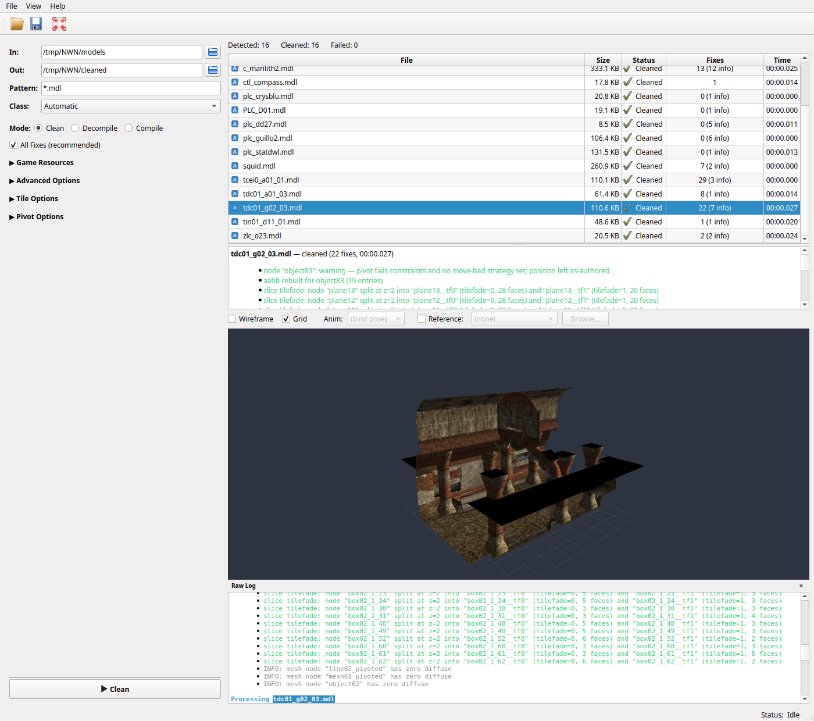
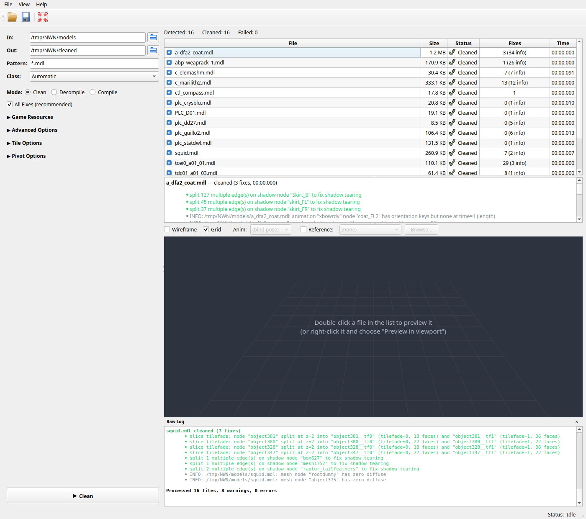
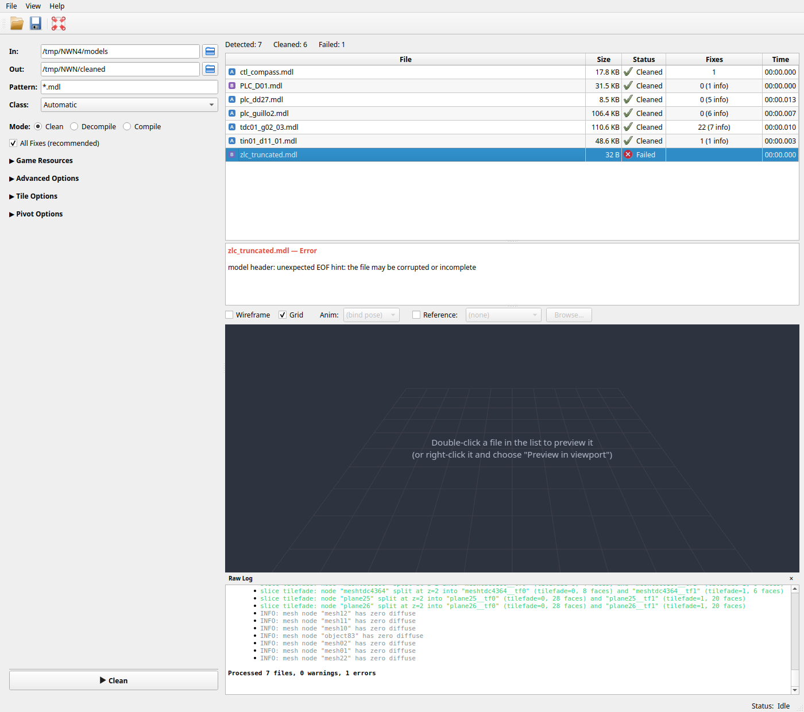
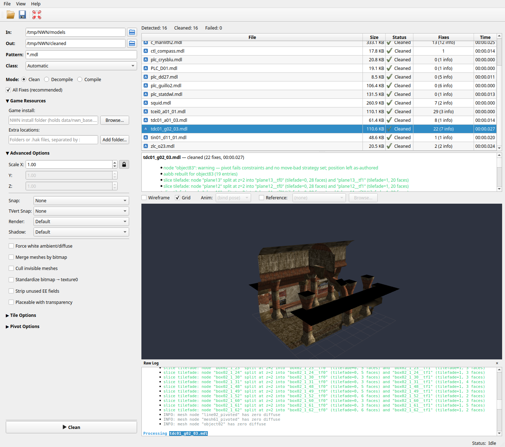
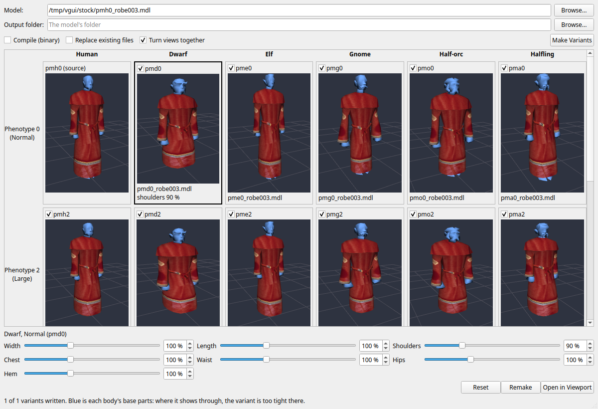
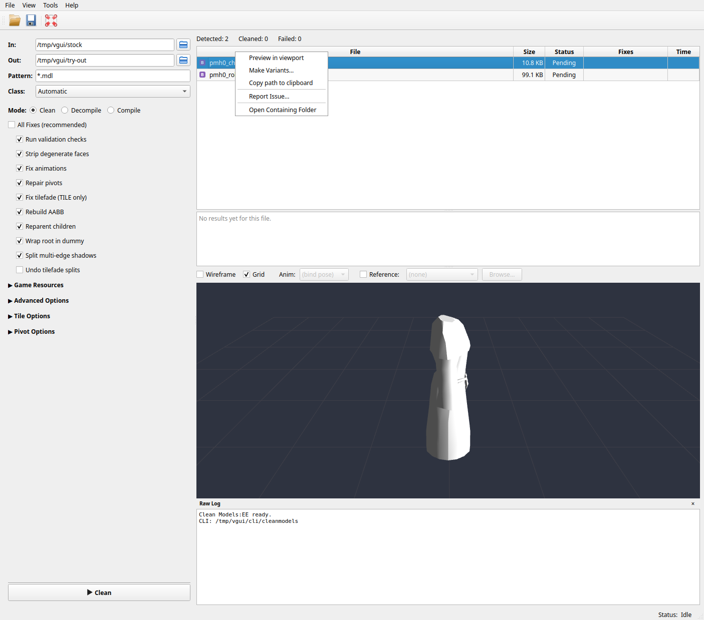
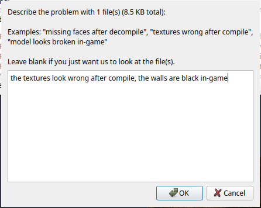

# cleanmodels-qt

Qt6 GUI for [cleanmodels](https://github.com/plenarius/cleanmodels), a tool to validate, repair, compile, and decompile Neverwinter Nights MDL model files.

 



## Features

- Pick a folder (or drag one in) and run check, repair, compile, or decompile over every model in it, with per-file progress and status
- A findings column and a detail pane per file: what was wrong, what was fixed, and any warnings the parser raised on damaged lines
- 3D model preview with an OpenGL viewport: **double-click a file** in the list, or right-click and choose *Preview in viewport*
- **Make Variants** (*Tools* menu, or right-click a model): make a robe's, cloak's or armour part's versions for the other races (custom ones from your haks too) and phenotypes, see them all on their bodies in one grid, and reshape any of them with sliders (width, length, shoulders, chest, waist, hips, hem)
- Full access to the cleanmodels repair, transform, and tile options
- Persistent settings for directories, options, and camera

## Screenshots

Run a folder through Clean, Decompile or Compile and see every file's result. Click a file for what was fixed and what was only noted:



ASCII and binary models are marked **A** and **B**. A file that cannot be processed is shown as Failed, with the reason in the details pane:



The repair, transform and tile options are in the panel on the left:



*Make Variants* fits a robe, cloak or armour part to every body that wears that kind of model and shows each on its body: the variant with its texture (coloured as in game), the body's base parts in solid blue (for a robe, only the parts the game shows under it). Where blue shows through, that variant is too tight there. The bodies come from the game install and the haks under *Game Resources*, so custom races appear as their own columns. Phenotypes of the same shape share a tile ("also phenotypes 9, 15-21"): robes and cloaks need a copy for every phenotype that has them, mounted and fighting styles included, and those get the tile's fit, renamed. Click a tile to adjust it: overall width and length, and the width at the shoulders, chest, waist, hips and hem (sleeves stay on the arms). A change remakes that tile's bodies after a moment (Enter in a box at once), and the tile keeps your zoom; Reset goes back to the fit. The tile's notes, if any, show below the grid. Double-click a tile to open it in the main viewport. Views turn together and are lit from the camera, so you can look at all of them from the back at once. If versions already exist in the output folder, it asks whether to replace or skip them:



<details>
<summary>More: the right-click menu and the bug report prompt</summary>

Right-click a file to preview it, make its variants, copy its path, report a problem, or open its folder:



*Report Issue* asks what is wrong and sends the model to the cleanmodels issue tracker; Cancel sends nothing:



</details>

## Download

Grab the latest build for your platform from the [Releases](https://github.com/plenarius/cleanmodels-qt/releases) page:

| Platform | File |
|---|---|
| Linux (x86_64) | `cleanmodels-qt-linux-amd64.AppImage` (mark it executable, then run it) |
| Linux (ARM64) | `cleanmodels-qt-linux-arm64.AppImage` |
| macOS | `cleanmodels-qt-macos.zip` |
| Windows (x86_64) | `cleanmodels-qt-windows-amd64.zip` |

Each download already contains the matching [cleanmodels](https://github.com/plenarius/cleanmodels) command-line tool, so there is nothing else to install. The window shows which version it is using in the Raw Log (`CLI: <path>`). The builds are also on the [Neverwinter Vault](https://neverwintervault.org/project/nwnee/other/tool/clean-models-extended-edition-model-decompile-repair-and-compile); GitHub always has the latest.

### Using your own cleanmodels

The app uses the `cleanmodels` next to it first, then one in your `PATH`. To run a newer or custom build, put it beside the app or on your `PATH`. It must be the Go-based cleanmodels **v4 or newer** (*Make Variants* needs **v4.7** or newer); the legacy Prolog CLI is not supported (for the old Prolog-based GUI, see [cleanmodels-qt v0.8.0](https://github.com/plenarius/cleanmodels-qt/releases/tag/build0.8.0-HEAD)).

When you build from source (below), the build does not bundle the CLI, so you need to supply one this way.

## Building from source

Requires Qt 6.7+ with OpenGL support, CMake 3.16+, and a C++17 compiler.

### Linux (Ubuntu/Debian)

```
sudo apt-get install qt6-base-dev qt6-opengl-dev libgl1-mesa-dev
git clone https://github.com/plenarius/cleanmodels-qt
cd cleanmodels-qt
cmake -B build -DCMAKE_BUILD_TYPE=Release
cmake --build build --parallel
```

### macOS

```
brew install qt@6
git clone https://github.com/plenarius/cleanmodels-qt
cd cleanmodels-qt
cmake -B build -DCMAKE_BUILD_TYPE=Release -DCMAKE_PREFIX_PATH=$(brew --prefix qt@6)
cmake --build build --parallel
```

### Windows

Install Qt 6.7+ via the [Qt Online Installer](https://www.qt.io/download-qt-installer), then:

```
git clone https://github.com/plenarius/cleanmodels-qt
cd cleanmodels-qt
cmake -B build -DCMAKE_BUILD_TYPE=Release -DCMAKE_PREFIX_PATH=C:\Qt\6.7.0\msvc2022_64
cmake --build build --config Release
```

## License

MIT
